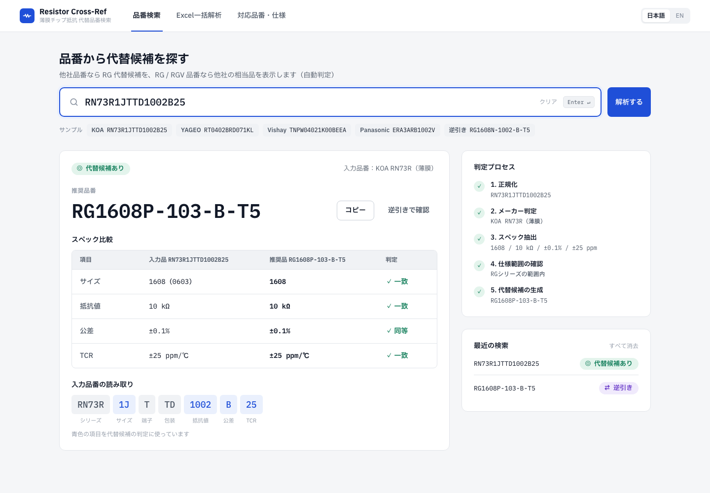
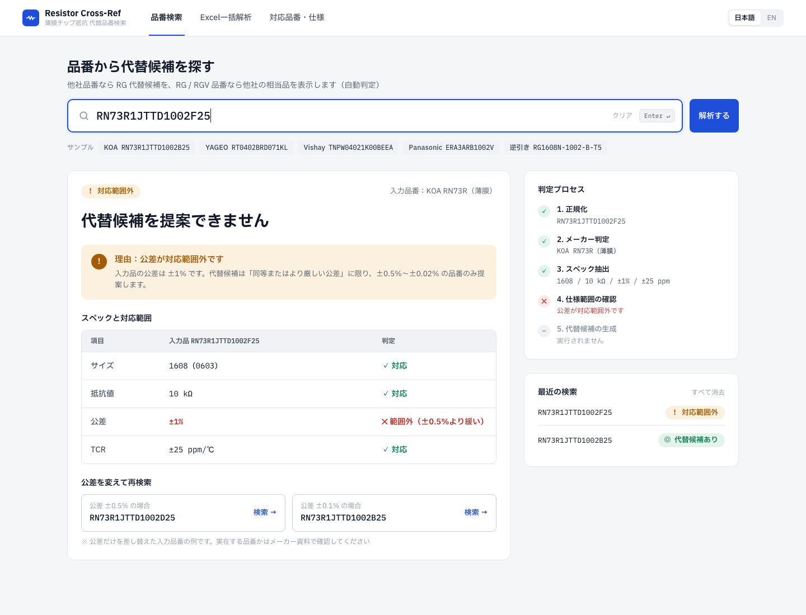
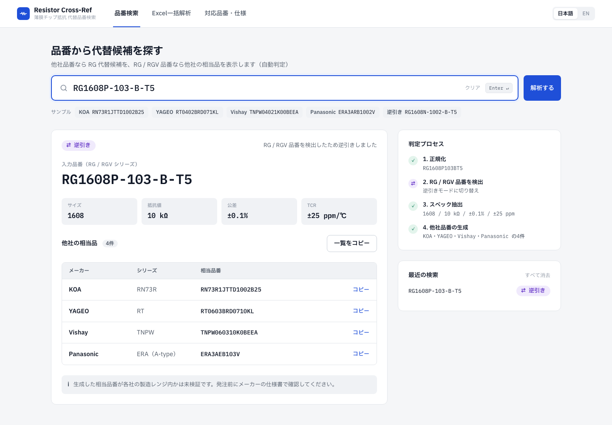
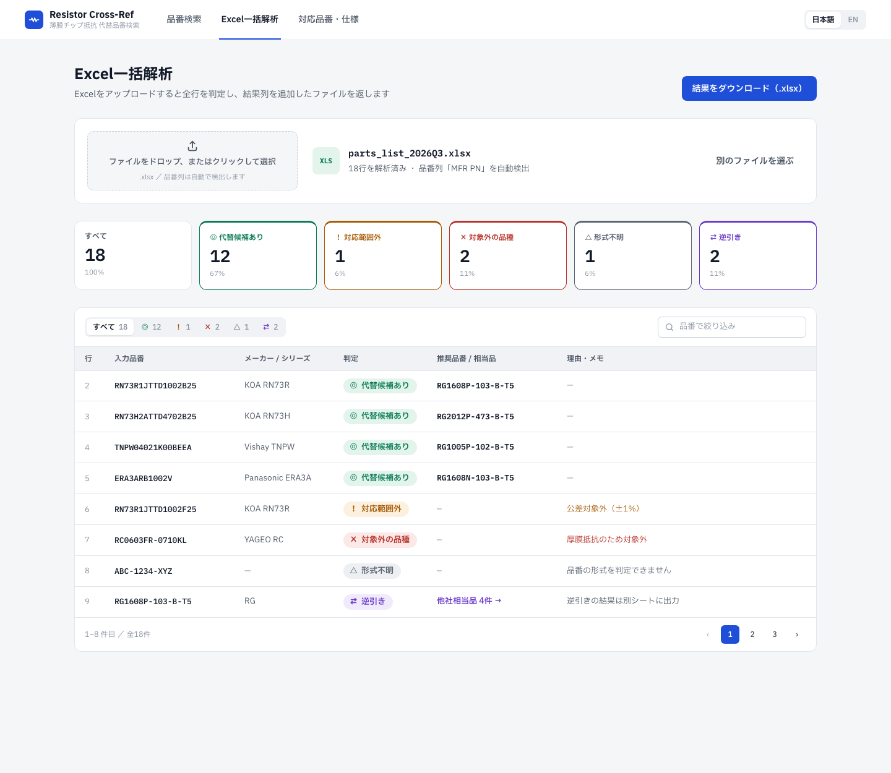
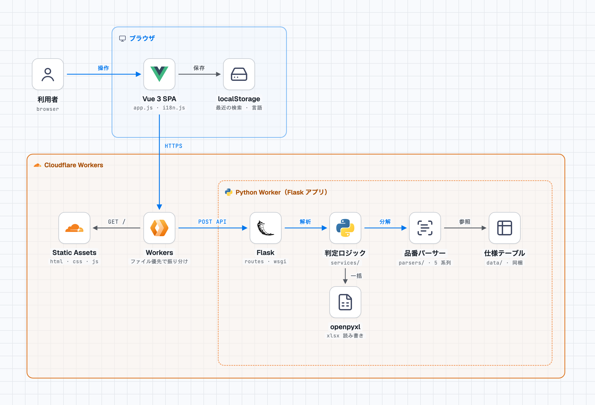

# Resistor Cross-Ref — 薄膜チップ抵抗 代替品番検索ツール

電子部品メーカー4社（KOA・YAGEO・Vishay・Panasonic）の薄膜チップ抵抗の品番を入力すると、RG / RGV シリーズの代替候補品番を提案する Web アプリです。
逆方向（RG / RGV 品番 → 他社相当品）の検索と、Excel による一括解析にも対応しています。

業務で発生していた「品番を見てカタログを引き、代替品を手で探す」作業を効率化するために開発した個人開発プロジェクトです。
判定ロジックだけでなく、**なぜその結果になったのかが画面上で分かること**を重視して設計しています。

**デモ：https://resistor-cross-reference.shu8719.workers.dev**



次のリンクからは、例の品番を検索した状態で開けます。

| 例           | 品番 |
| ----------- | --- |
| ◎ 代替候補あり     | [RN73R1JTTD1002B25](https://resistor-cross-reference.shu8719.workers.dev/?pn=RN73R1JTTD1002B25) |
| ！ 対応範囲外（公差） | [RN73R1JTTD1002F25](https://resistor-cross-reference.shu8719.workers.dev/?pn=RN73R1JTTD1002F25) |
| ⇄ 逆引き       | [RG1608N-1002-B-T5](https://resistor-cross-reference.shu8719.workers.dev/?pn=RG1608N-1002-B-T5) |

## 特徴

* **品番を1件入れるだけ** — サイズ・抵抗値・公差・TCR（温度係数）を品番から自動抽出し、代替候補品番を提案します
* **判定プロセスの可視化** — 正規化 → メーカー判定 → スペック抽出 → 仕様範囲の確認 → 代替候補の生成、の各ステップを結果の横に表示します
* **提案できない理由を説明** — 「公差が対応範囲外です」のような理由文と、スペックごとの対応／範囲外の表を返します
* **公差を変えて再検索** — 公差だけが原因のときは、公差コードを差し替えた入力品番を候補として提示します
* **逆引き** — RG / RGV 品番から、KOA・YAGEO・Vishay・Panasonic の相当品番を生成します
* **Excel 一括解析** — アップロードした全行をその場で一覧でき、判定別の件数・絞り込み・ページ送りのあと `.xlsx` でダウンロードできます
* **日本語 / English 切替**、**最近の検索**（ブラウザに5件保存）

## 画面

UI は Figma で設計し、デザイントークンを CSS 変数として実装しています。

### 単体解析 — 提案できない場合



### 逆引き（RG → 他社）



### Excel 一括解析



## 対応している品番

| メーカー          | シリーズ            | 入力例                 |
| ------------- | --------------- | ------------------- |
| KOA           | RN73R / RN73H   | `RN73R1JTTD1002B25` |
| YAGEO         | RT              | `RT0402BRD071KL`    |
| Vishay        | TNPW            | `TNPW04021K00BEEA`  |
| Panasonic     | ERA（A-type のみ）  | `ERA3ARB1002V`      |
| RG / RGV シリーズ | RG / RGV（逆引き）   | `RG1608N-1002-B-T5` |

※ 代替候補の提案は RG シリーズのみ対応しています。RGV シリーズ（3225 サイズ・高抵抗）は包装コードテーブルが未整備のため、現状は「対応範囲外」になります。
※ 公差は「同等またはより厳しい」ものだけを提案します（例: ±0.25% → ±0.1%）。±0.5% より緩い品番、RG の最小公差 ±0.02% より厳しい品番は「対応範囲外」になります。

## 判定結果の意味

| バッジ        | API の値    | 意味                                 |
| ---------- | --------- | ---------------------------------- |
| ◎ 代替候補あり   | `◎`       | 代替候補品番の提案あり                        |
| ！ 対応範囲外    | `！`       | サイズ・抵抗値・公差・TCR のいずれかが RG の対応範囲外     |
| × 対象外の品種   | `×`       | 厚膜抵抗・MELF など、ツールの対象外               |
| △ 形式不明     | `△`       | 品番の形式を判定できない、またはコードが未定義            |
| ⇄ 逆引き      | `REVERSE` | RG / RGV 品番を検出し、他社相当品を生成           |

## 使い方

Excel 一括解析では、列名に「PN」または「PART」を含む列を品番列として自動で検出します。`sample/sample_input.csv` を `.xlsx` に変換すると試せます。

### ローカルで動かす

[uv](https://docs.astral.sh/uv/) を使います。

```bash
uv sync                # 依存ライブラリをインストール
uv run python app.py   # http://localhost:5000 で起動
uv run pytest          # テストを実行
```

Cloudflare へのデプロイは `uv run pywrangler deploy` で行います。

## システム構成

Cloudflare Workers の静的アセットと Python Worker（Flask）だけで動くステートレスな構成です。
ファイルがあるリクエストは Static Assets が返し、API（`POST /analyze` など）だけが Flask に届きます。サーバー側に DB・セッションは持たず、仕様テーブルはコードに同梱しています。

<picture>
  <source media="(prefers-color-scheme: dark)" srcset="docs/images/architecture-dark.png">
  
</picture>

## 技術スタック

| 分類 | 技術 |
| --- | --- |
| バックエンド | Python / Flask |
| Excel 読み書き | openpyxl |
| フロントエンド | Vue 3 / Tailwind CSS |
| デザイン | Figma |
| テスト | pytest |
| ホスティング | Cloudflare Workers（Python Workers） |

## API

| エンドポイント               | 内容                                                          |
| --------------------- | ----------------------------------------------------------- |
| `POST /analyze`       | 品番1件を解析。判定・推奨品番に加えて、判定プロセス・品番の分解・スペック比較・理由文（日英）を返します             |
| `POST /analyze_bulk`  | Excel を解析し、行ごとの判定を JSON で返します（画面の一覧表示用）                        |
| `POST /upload_bulk`   | Excel を解析し、結果列を追加した `.xlsx` を返します（逆引き行は「Reverse Lookup」シート） |

## プロジェクト構成

```text
resistor-cross-reference-tool/
├── app.py          # アプリの起動・ルート登録
├── routes/         # URL と HTTP メソッドの定義
├── services/       # 判定・代替品番生成・逆引き・判定理由の組み立て・一括処理
├── parsers/        # メーカーごとの品番パーサーと、解析結果のモデル ParsedPN
├── utils/          # 品番正規化・抵抗値コード変換・表示の整形などの共通関数
├── data/           # 仕様テーブルや定数の定義
├── static/         # CSS / JS（Vue アプリ・翻訳辞書）/ SVG アイコン
├── templates/      # HTML
├── tests/          # pytest
├── worker.py       # Cloudflare Workers の入口
├── wrangler.jsonc  # Cloudflare Workers の設定
├── scripts/        # Cloudflare へのアップロード内容を組み立てるスクリプト
└── pyproject.toml  # 依存ライブラリ
```

## 工夫した点

### 「なぜその結果か」を画面で説明する

画面向けの説明は、`services/explain.py` で判定結果から組み立てています。
理由文は日英の両方を返すので、言語を切り替えても再リクエストは発生しません。公差の再検索候補も、差し替えた品番を実際に判定し直し、代替候補が出るものだけを提示しています。

### メーカーごとにパーサーを分けた

KOA・YAGEO・Vishay・Panasonic・RG / RGV のパーサーを独立したファイルにし、それぞれが「スペック」と「品番のセグメント」を返します。
新しいメーカーを追加する場合も、既存コードへの影響を抑えやすい構成です。

### 単体解析と一括解析で同じ判定を使う

判定は `services/analyzer.py` の `analyze_pn` に一本化し、単体解析の画面・一括解析の一覧・Excel 出力はすべて同じ判定結果から組み立てています。
代替品を提案できない理由は、文言ではなく理由コード（公差・TCR・サイズなど）で受け渡し、単体解析の理由文も一括解析の短い理由も、このコードから組み立てています。

## 今後の改善点

* 逆引きで生成する品番が各社の製造レンジ内かを検証する
* 対応メーカー・シリーズを追加する
* 一括解析の結果表から、各行の判定プロセスを開けるようにする
* パーサーの判定結果（対象外・範囲外・不明）を、日本語の文字列ではなく状態コードで持つ
* Tailwind CSS を Play CDN からビルド済みの CSS に切り替える
